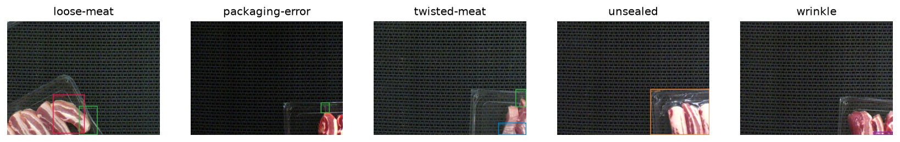
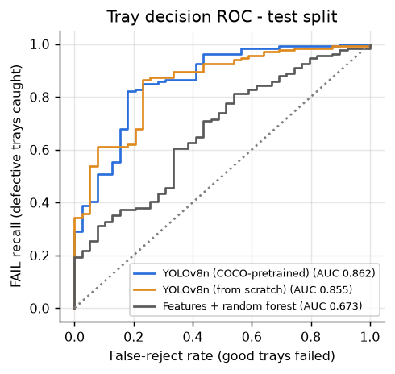
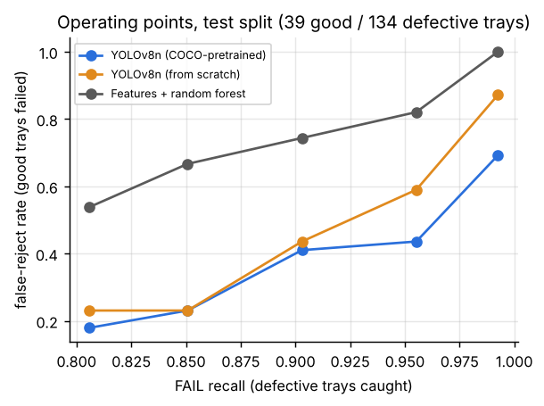
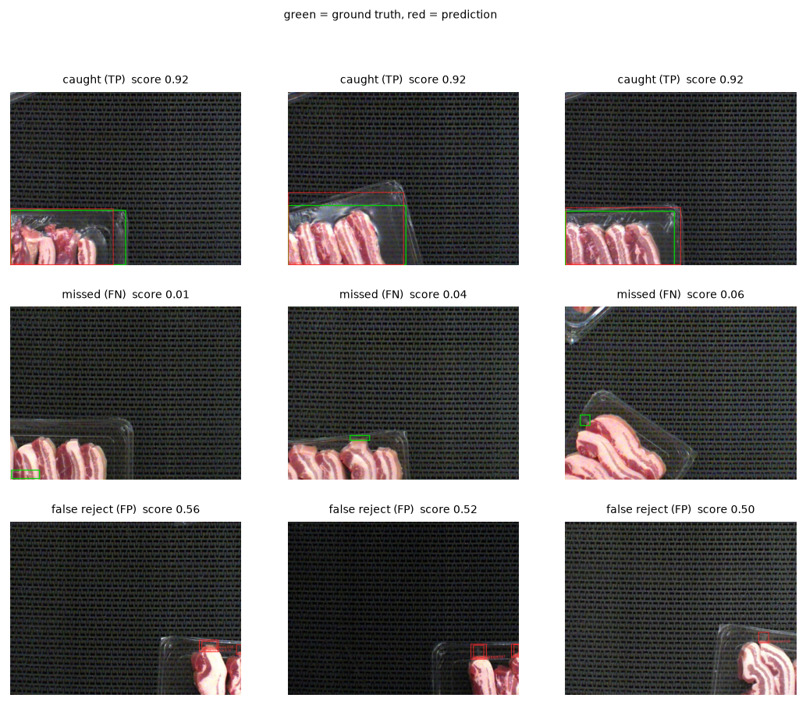
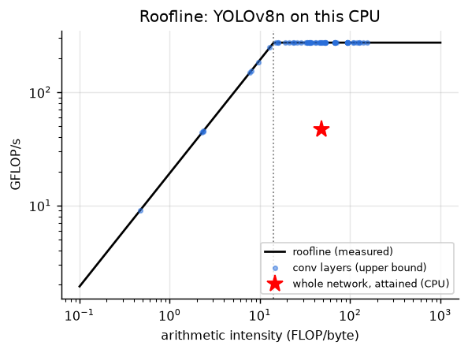
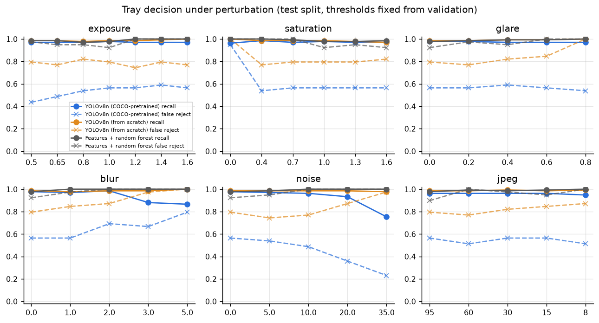
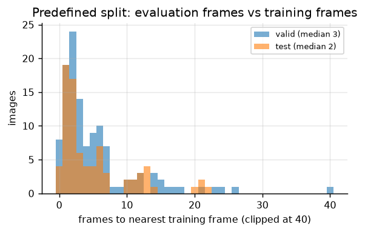
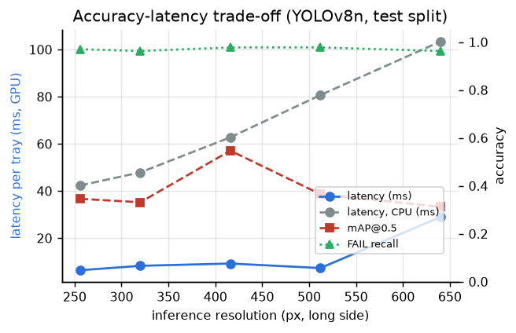

# Automated Detection of Pork-Rasher Packaging and Placement Defects

**MMA3001 Numerical Methods and Machine Learning — Individual Project Report**
Author: Haruku Nishikawa · Co-author: Claude (Anthropic) · Repository: [github.com/Lytena/rasher-qc](https://github.com/Lytena/rasher-qc) · October 2026

> Every number below comes from `results/<dataset>/SUMMARY.md` (written by `scripts/06_summary.py`) or `results/<dataset>/tables/operating_points.json` (`scripts/07_operating_points.py`); nothing was typed in by hand. The real-data models were trained on my laptop (RTX 4070 laptop GPU, Intel Core with 20 logical CPUs, Windows 11); the synthetic run used a 2-core cloud Xeon. `-block` is the leakage-aware split and `-reduced` the predefined one (Section 2.2).

---

## 1. Engineering problem

**Context.** Bacon is packed by laying a few rashers in a plastic tray and heat-sealing a lidding film onto the tray's flange. Both steps go wrong. Rashers end up *loose* (out of place, hanging over the edge) or *twisted*. The film ends up *unsealed* along part of the flange, *wrinkled*, or damaged in some other way (*packaging-error*). An unsealed pack leaks, loses its protective atmosphere and spoils early; a messy one gets sent back by the retailer. Most lines still check this by eye — one person watching trays go past at about one a second. That is tiring, it drifts over a shift, and it leaves no record.

**What I set out to do.** Given one top-view RGB photo of a sealed tray on the conveyor:
1. **find and box** every defect of the five labelled types (box, class, confidence);
2. **decide** whether the tray passes, fails, or goes to a person (PASS / FAIL / REVIEW);
3. **find out** whether that is accurate *and* fast enough to run on a line — and how far the accuracy numbers can actually be trusted.

**Why it matters.** The two mistakes don't cost the same. Letting an unsealed pack through is a food-safety and recall problem; failing a good pack costs someone a second look. So I judge the system mainly by how many defective trays it catches for a given rate of good trays wrongly failed, not by a detection score alone.

**Intended use.** A helper at the end of the packing line, not a replacement for the operator. Clear passes go through, clear fails are diverted, the uncertain middle goes to a person, and every tray gets a machine-readable record (`results.json`). It is not meant to make calls on defect types the data can't validate (Section 5).

**What's out of scope.** Only the five labelled defects and this dataset's camera set-up (fixed overhead camera, dark textured belt, clear trays, 720 × 540 images). No seal-strength or leak testing — a seal can look fine and still leak — no weight or slice counts, no hardware integration, and no claims about other products, trays or lighting.

## 2. Inputs, outputs and data

### 2.1 Top-level inputs and outputs

| | Item | Format, units, domain | Meaning and use |
|---|---|---|---|
| In | Tray image | RGB, uint8 (0–255), 720 × 540 px; accepted range 240–8192 px per side; one tray, top view | The only input at run time |
| In | Training data | YOLO export (`data.yaml`; `labels/*.txt` = class, centre x, centre y, width, height, normalised 0–1) or COCO JSON (pixels) | Training and evaluation only |
| Out | Decision | `PASS`, `REVIEW`, `FAIL`, `UNSUPPORTED_INPUT` | What the line does with the tray |
| Out | Tray score | 0–1: highest confidence among detected defects | Ranking; setting thresholds |
| Out | Defect list | class; confidence 0–1; box `x1, y1, x2, y2` in pixels (origin top-left); box area as a fraction of the image | Shows the operator where to look; rough severity ranking |
| Out | Run report | `results.json`, annotated JPEGs, `summary.html` | Traceability and a supervisor overview |

**Bad, missing or unsupported inputs** (`rasherqc.io.validate_image`). I'd rather the system admit it can't read an image than guess. Missing or undecodable files, greyscale images (colour is part of the evidence), RGB images whose three channels are identical, images too small to resolve a crease (side < 240 px), and badly under- or over-exposed images (mean grey level outside 20–235, or more than 25 % of pixels clipped) all come back as `UNSUPPORTED_INPUT` with the reason. None of them is ever passed automatically. RGBA images are accepted with the alpha channel dropped and a warning logged. On the training side, unknown class ids or malformed label lines raise an error instead of being quietly skipped. Function-level inputs and outputs are documented in Google-style docstrings and in the generated HTML API docs (`docs/api/index.html`).

### 2.2 The dataset — and what the audit turned up

*Pork Rasher Error (Packaging)* (Roboflow Universe, version 4, CC BY 4.0): 3,549 images at 720 × 540, made of 3,349 training images (three copies of each of 1,085 source frames, with ±10 % exposure changes), 120 validation and 80 test images, and boxes for five classes. Before training anything, `scripts/01_data_audit.py` and `scripts/00_prepare_real.py` audited it. Three things came out of that, and they reshaped the project.

1. **The images are video frames, and the predefined split leaks.** The file names give it away: `frame_with_red_<n>`. Measuring each validation and test image's distance to the nearest training frame gives a median of **2.5 frames for test and 3 for validation**. 57 % of test images sit within 3 frames of a training image, all of them within 30, and 5 % share the exact frame number with a training image (they differ only by the exposure tweak). In other words, a "test" tray is usually the *same physical tray* a fraction of a second after one the model trained on. A perceptual-hash check flagged 143 validation/test images as near-duplicates of training images. Scores on this split were always going to look too good.
2. **The classes are badly imbalanced.** Training has 1,712 `packaging-error`, 1,055 `unsealed`, 72 `twisted-meat`, 66 `loose-meat` and 18 `wrinkle` boxes (counting all three copies). Validation and test have no `wrinkle` at all and only 3–4 `loose-meat` and `twisted-meat` boxes each. Only `packaging-error` and `unsealed` can be measured, so I call a class *evaluable* only if it has at least 10 test boxes — below that, one box moves AP by 10 points or more.
3. **There are hardly any good trays to test on.** Only 12 of the 80 test images have no defect, so any false-reject rate measured there has a very wide confidence interval.

**What I did about it.** The code builds two versions of the dataset automatically (`rasherqc.dataset`):
* **Predefined split (`-reduced`)** — the split as given, keeping one of the three copies per training frame. The detector does its own, wider colour augmentation anyway, so the extra copies mostly just tripled training time.
* **Leakage-aware block split (`-block`)** — all source frames are cut into blocks of 300 consecutive frame numbers; whole blocks go to test or validation, and any training frame within 60 frames of a held-out one is dropped. That leaves 872 training, 155 validation and 173 test frames (72 training frames lost to the buffer). As a bonus, its test set has more boxes for the two evaluable classes (98 `packaging-error`, 51 `unsealed`) and more good trays (39), so its numbers are less noisy.

Running everything on both splits lets me measure how optimistic the predefined split is, rather than just asserting it (Section 5.4).

{width=100%}

### 2.3 Synthetic verification dataset

A procedural generator (`rasherqc.synthetic`) draws tray images in the same YOLO format, with the same class names and — the whole point — **boxes that are exactly right**. It does the job a manufactured solution does in numerical methods: if the pipeline can't score perfect labels perfectly, the bug is in my code, not in the data. It also lets me vary one thing at a time, like defect size or glare. It tells me nothing about real trays, though, and the real scenes (clear trays half in view on a dark textured belt) look quite different from what I generated. So it is used for verification only.

## 3. Computational solution

### 3.1 Pipeline

`image → validation (io) → YOLOv8n detector → per-class boxes + confidences → tray score s = max defect confidence → decision (PASS / REVIEW / FAIL) → report`

### 3.2 Main method: YOLOv8n with transfer learning

**How it works.** YOLOv8 is a one-stage, anchor-free convolutional detector. A CSP-Darknet backbone built from C2f blocks pulls out feature maps at strides 8, 16 and 32, and a path-aggregation neck mixes them, so a small defect (a lifted film corner) and a big one (a loose rasher) both get represented. A decoupled head then predicts, for every cell of every feature map, the class probabilities and the distances from that cell to the four box edges, each as a small probability distribution. Training minimises the weighted sum of three losses: binary cross-entropy on the classes, CIoU on box overlap, and distribution focal loss on the edge distributions. A task-aligned assigner decides which cells are responsible for which ground-truth box. The optimiser is AdamW (mini-batch stochastic gradient descent with decoupled weight decay), and the weights kept are those from the epoch with the best validation fitness, 0.1·mAP@0.5 + 0.9·mAP@0.5:0.95. At inference, non-maximum suppression (IoU 0.6) throws away duplicate boxes.

**Why this one.**
* **It localises.** The brief asks to detect *and localise*, and an operator needs to know where to look.
* **It's fast.** One forward pass per image fits a line doing about one tray a second. The nano version has 3.0 M parameters and runs fine on a CPU (Section 6).
* **It copes with little data.** Starting from COCO-pretrained weights reuses generic edge, texture and shape features — handy with only 1,085 distinct training frames. I test that claim directly against training from scratch (Section 4).
* **The labels fit.** The data is already boxed, so no re-labelling.
* **It's reproducible.** Widely used, well documented, and the same code runs on CPU and GPU.

**Assumptions.**
1. A defect is visible in a single top-view RGB frame.
2. The box labels are consistent enough to learn from.
3. Training, validation and test images come from the same process — same camera, belt and trays.
4. A tray's status can be summed up by its most confident defect.

**Settings** (`rasherqc.config`, `rasherqc.detector.train`). Input 416 px on the long side; 60 epochs on the GPU (20 on an early CPU run), batch 16, AdamW with an automatically chosen learning rate (≈ 1.1 × 10⁻³), early-stopping patience 15, seed 42 with `deterministic=True`. Augmentation: mosaic (turned off for the last 5 epochs), horizontal and vertical flips (a camera looking straight down has no "up"), and HSV jitter. No rotation — the trays always run along the belt.

**Implementation.** `rasherqc.detector` wraps Ultralytics 8.4. One trap worth mentioning: Ultralytics expects OpenCV's BGR channel order, while everything else in my code is RGB. Get it wrong and nothing crashes; red meat just quietly turns blue. A unit test checks that passing an image as an array or as a file gives identical detections.

### 3.3 Tray decision

With tray score *s*: **FAIL** if *s* ≥ *t*fail, **REVIEW** if *t*low ≤ *s* < *t*fail, otherwise **PASS**. Both thresholds are set on the **validation** split. *t*fail is the highest threshold that still catches at least 95 % of defective validation trays; *t*low is the highest that catches at least 99 %, and anything in between goes to a person. Those targets encode the lopsided costs from Section 1. They're engineering choices a plant would set for itself, not results.

### 3.4 Known limitations of the method

* Boxes are axis-aligned, so box area overstates the true defect area. Fine for ranking severity, not for measuring it.
* The model can't find what it has barely seen: there are 6 `wrinkle` training boxes in the reduced set.
* Confidence scores aren't calibrated probabilities. Change the camera, lighting or product and the thresholds have to be picked again.
* Ultralytics is AGPL-3.0. A closed-source commercial version would need a commercial licence or a different detector.

## 4. Alternative solutions

| | Method | What it tests | Localises? |
|---|---|---|---|
| A | **YOLOv8n, COCO-pretrained** (main) | — | yes |
| B | **YOLOv8n from scratch**: same architecture, data, settings and seed; random starting weights | whether transfer learning pays off at this data size | yes |
| C | **Hand-crafted features + random forest**: 80 colour, texture, morphological and orientation features; 500 trees chosen by 5-fold cross-validation on the training split | whether a cheap, classical, explainable pipeline is good enough for PASS/FAIL | no (whole image only) |

The baseline's features were built around what each defect physically looks like. In a good pack the rashers lie parallel, so edge orientations agree; a loose rasher adds a second dominant direction. Wrinkles and lifted film edges are thin and bright, which a white top-hat filter picks up; an unsealed flange shows a dark gap, which a black top-hat picks up. A 3 × 3 spatial pyramid pools these so a small local defect doesn't get averaged away. All three methods produce a 0–1 tray score and go through the *same* threshold procedure (Section 3.3), so their tray decisions compare like for like.

**Table 1 – Method comparison on the test split.** Main numbers: leakage-aware block split (173 trays: 134 defective, 39 good); in brackets: predefined split (80 trays: 68 / 12). Thresholds chosen on validation (Section 3.3); 95 % bootstrap CIs.

| | A: YOLOv8n pretrained | B: YOLOv8n scratch | C: features + RF |
|---|---|---|---|
| mAP@0.5, evaluable classes | **0.783** (0.589) | 0.654 (0.482) | — |
| mAP@0.5:0.95, evaluable classes | **0.387** (0.317) | 0.314 (0.294) | — |
| AP@0.5 `unsealed` / `packaging-error` | 0.871 / **0.696** (0.851 / 0.328) | 0.827 / 0.481 (0.840 / 0.125) | — |
| Tray ROC AUC | **0.862** [0.78, 0.92] (0.924) | 0.855 [0.79, 0.91] (0.908) | 0.673 [0.57, 0.76] (0.763) |
| False-reject rate at FAIL recall ≈ 0.90 † | **0.41** [0.26, 0.56] (0.08) | 0.44 [0.28, 0.59] (0.08) | 0.74 [0.61, 0.87] (0.50) |
| False-reject rate at FAIL recall ≈ 0.80 † | **0.18** [0.06, 0.31] (0.08) | 0.23 [0.10, 0.37] (0.08) | 0.54 [0.39, 0.69] (0.33) |
| With the validation-chosen thresholds: escape / review / false-reject | 1.5 % / 2.9 % / 56 % | 0.7 % / 3.5 % / 80 % | 0.7 % / 2.9 % / 92 % |
| CPU latency per tray, mean (p95) | 63 ms (80) | ≈ same model size | 385 ms (features 214 ms + RF 165 ms) |
| Training time (RTX 4070) / data needed | 30 min, boxes | 14–35 min, boxes | 3 min on CPU, image labels only |
| Interpretability | boxes show *where*; class + confidence | same | feature importances; no location |

† Descriptive operating points read off the test ROC (`07_operating_points.py`) to show the trade-off. The decision thresholds themselves are only ever chosen on validation.

{width=49%} {width=49%}

**Which one, and why.** I picked the pretrained detector (A). It is best or tied-best on every accuracy measure on both splits. Pretraining matters most on the hard class: `packaging-error` AP is 0.70 against 0.48 from scratch on the block split, and 0.33 against 0.13 on the predefined one. `unsealed` — big and high-contrast — is learned almost as well from scratch. To be fair to B, its validation curve was still climbing at epoch 60 (best epoch 54), while A had levelled off (best epoch 49, or 42 with early stopping on the predefined split). Some of B's gap is just training budget. At the same budget, though, pretraining wins.

The classical baseline (C) isn't good enough. On the block split it has to fail 74 % of good trays to catch 90 % of bad ones, it falls apart under every perturbation I tried (Section 6.4), and it can't say where the defect is. Its feature importances were the interesting part: the top features were the low percentiles of CIE b* (roughly, how much bare tray and film is visible next to meat) and the background's edge-orientation histogram. So the forest is mostly working out *how much of a tray is in the frame*, not spotting defects — which explains why it transfers so badly to unseen trays. Its one real advantage is cost: no GPU, and only image-level labels.

**What A still can't do.** Even A falls short of a demanding target on unseen trays. Catching about 90 % of defective trays costs about 41 % false rejects; at 80 % recall that drops to about 18 %. The error gallery (Section 5.3) shows where most of this comes from: trays only partly in the frame, where the model finds a plausible `packaging-error` at the film edge that nobody labelled.

## 5. Validation

### 5.1 What is validated, and how

| Question | Method | Metric / criterion |
|---|---|---|
| Is the code right? | Tests against hand-calculated cases; synthetic data with exact ground truth; my metric code checked against Ultralytics' validator | Tests pass; my mAP matches the library's up to interpolation differences |
| How well are defects localised? | Withheld test split | AP@0.5 per evaluable class, mAP@0.5, mAP@0.5:0.95 |
| How good is the tray decision? | Thresholds fixed on validation, applied **once** to test; 95 % bootstrap CIs (1,000 resamples of test images) | FAIL recall (share of defective trays caught), false-reject rate, ROC AUC, escape and review rates |
| How optimistic is the predefined split? | Same pipeline on the block split | Difference in the metrics above |
| How robust is it? | Controlled perturbations of test images, thresholds fixed | Recall and false-reject rate against perturbation strength (Section 6.4) |

**Why these metrics.** mAP is the standard for detection: it includes localisation (IoU ≥ 0.5) and ranks predictions at every confidence level. But the line acts on trays, not boxes, so the decision metrics come first — recall on FAIL trays, because escapes are the expensive mistake, and the false-reject rate, because that is what running the system costs. Bootstrap intervals are there because the test sets are small. **Effect on model selection:** validation data picked the best epoch and the thresholds, and cross-validation on training data picked the baseline's hyper-parameters. The test split was touched once, after all of that.

### 5.2 Verification of the implementation

Verification asks a narrower question than validation: does the code compute what it says, whether or not the model is any good? I used five checks (details in Appendix A). **(i)** The metric code against cases worked out by hand and against scikit-learn — this caught a genuine bug in my first COCO-style AP. **(ii)** My mAP against the independent Ultralytics validator: 0.547 vs 0.542 (block) and 0.344 vs 0.338 (predefined) for the pretrained model. **(iii)** The data loaders, via a YOLO↔COCO round trip and a deliberately planted cross-split duplicate. **(iv)** The whole pipeline on the synthetic set, where the detector reached mAP@0.5 = 0.978 and a perfect tray ROC — so the much lower real-data scores reflect the problem, not my code. **(v)** Every unsupported-input case from Section 2.1. In total **80 tests** pass (`results/test_report.html`), on Linux and on Windows.

### 5.3 Results on the real data

**Detection.** On the block split the pretrained detector reaches AP@0.5 = 0.871 for `unsealed` and 0.696 for `packaging-error` (mAP@0.5:0.95 = 0.387; at confidence 0.25, precision/recall are 0.84/0.75 and 0.69/0.68). Validation mAP on the same classes (0.765) sits close to test (0.783), so picking the best epoch on validation didn't over-fit it. The other three classes have one test box each on the block split (3–4 on the predefined one), so I don't report them — their APs jump between 0 and 1 on a single detection. Detection rate at the operating threshold is 0.80–0.92 in every defect-size bin from < 0.2 % to > 5 % of the image, apart from 0.5–1 % (0.62, n = 16) (`results/pork-rasher-block/figures/recall_vs_size.png`). Small defects aren't being systematically missed.

**Tray decision.** With the validation thresholds (*t*fail = 0.079, *t*low = 0.048) the detector lets 2 of 134 defective test trays through (1.5 % escape), sends 2.9 % to review — and fails 56 % of good trays. The thresholds end up low because hitting 95 % recall on validation demands it; Table 1 shows the whole trade-off.

{width=80%}

**Where it goes wrong** (green = label, red = prediction). The *missed* trays have tiny `packaging-error` boxes right at the image edge or on a tray only partly in view. The *false rejects* are nearly all trays sliding in from the right: the model flags a `packaging-error` on the visible film edge of a tray whose defect, if it has one, hasn't entered the frame yet — or that the annotator didn't label in that particular frame. This isn't really the detector failing. It's a modelling problem: a *frame* is not a *tray*. Each tray appears in several consecutive frames, and the decision should be made once per tray, using all of them (Section 7).

### 5.4 How optimistic is the predefined split?

| Pretrained detector, test split | Predefined (leaky) | Block (leakage-aware) |
|---|---|---|
| Tray ROC AUC | 0.924 [0.80, 1.00] | **0.862** [0.78, 0.92] |
| False-reject rate at recall ≈ 0.90 | 0.08 [0.00, 0.29] | **0.41** [0.26, 0.56] |
| mAP@0.5, evaluable classes | 0.589 | 0.783 |
| Good trays in test | 12 | 39 |

At tray level things moved the way I expected: on trays the model has never seen, the decision is clearly worse, and the predefined split's false-reject estimate (1 of 12 good trays) would have badly oversold the system to a plant. Detection AP, on the other hand, went *up*. I didn't see that coming. Two effects are tangled together and this data can't separate them: the block test set is made up differently (98 `packaging-error` boxes against 23, mostly from busy stretches of video the model learns well), and the predefined test set is so small that its AP swings by a lot on one or two detections. So the honest conclusion is narrower than "the predefined split inflates everything." It is this: **the predefined split can't be used to estimate the false-reject rate**, because it has too few good trays and those it does have are near-copies of training frames. The block split, with three times as many good trays from unseen stretches of video, is the number an engineer should use.

### 5.5 What the validation cannot establish

* How it does on `wrinkle`, `loose-meat` and `twisted-meat`. With 0–4 test boxes each, any AP is an anecdote. The tray decision does include them, but its recall is dominated by `packaging-error` and `unsealed`.
* How it does on another day, shift, camera position, lighting, tray or product. Every frame seems to come from one recording session; even the block split only separates moments within it.
* Whether the labels are right. Some test boxes look debatable (where does `packaging-error` end and `unsealed` begin?), and nobody re-labelled them independently.
* Whether the seal actually holds. The system only knows what the camera sees.

## 6. Optimisation and performance

### 6.1 Is it fast enough?

A line packing 60 trays a minute gives **1,000 ms per tray**. All timings below are single-image, end to end (pre-processing, inference, NMS), measured after a warm-up.

| | 256 px | 320 px | **416 px** | 512 px | 640 px |
|---|---|---|---|---|---|
| Laptop CPU, mean / p95 (ms) | 42 / 50 | 48 / 55 | **63 / 80** | 81 / 97 | 103 / 126 |
| Laptop GPU, mean (ms) | 6.3 | 8.2 | **9.2** | 7.3 | 28.9 |
| GFLOPs per image (my counter) | 1.04 | 1.73 | **2.81** | 4.15 | 6.48 |
| mAP@0.5 evaluable (block test) | 0.728 | 0.749 | **0.783** | 0.741 | 0.691 |

**Yes — on a CPU alone, with about 12× headroom at p95.** No GPU needed at this line rate. The baseline (385 ms per tray) would also fit, it's just not accurate enough. I kept 416 px: it's the most accurate setting, and 640 px is both 1.7× slower and *less* accurate, most likely because the model was trained at 416 px and objects then appear at a scale it hasn't seen. The GPU numbers at batch 1 are mostly fixed per-call overhead rather than arithmetic, and they bounced around between runs on my laptop (about 9 ms in the final run, 30–40 ms in an earlier one, presumably a different power state). So I base the requirement on the CPU numbers. Batching does lift GPU throughput from 25 to 94 images per second (batch 1 → 16) — nice for re-checking a day's footage offline, irrelevant on a line that hands you one tray at a time. Peak memory was 1.8 GB, almost all PyTorch/CUDA runtime; the weights themselves are 6.5 MB.

### 6.2 FLOPs, arithmetic intensity and the roofline

I counted FLOPs layer by layer with forward hooks. For each convolution, FLOPs = 2·Cout·Hout·Wout·(Cin/groups)·kh·kw, and bytes = 4·(|input| + |weights| + |output|) for float32. The counter passes a hand-calculated unit test and agrees with the independent `thop` counter (2.81 vs 2.85 GFLOPs at 416 × 320; `thop` also counts a few non-convolution layers). The 64 convolutions range from 0.5 to 153 FLOP/byte in arithmetic intensity, 48 FLOP/byte for the network as a whole.

{width=50%}

On my laptop's CPU the attainable compute rate (a large matrix multiply) measured 274 GFLOP/s and the copy bandwidth 19 GB/s, putting the ridge point at about 14 FLOP/byte. Most layers, and the network overall, sit to the right of it. The roofline therefore says the model is **compute-bound** here and could at best run at about 274 GFLOP/s — roughly 10 ms per image. It actually manages **47 GFLOP/s (17 % of peak; 59 ms inference)**. So the gap isn't memory bandwidth; it's how inefficiently a CPU runs lots of small convolutions (short inner loops, data re-layout, thread synchronisation at every layer). The thread-scaling test points the same way: one thread (55 ms) beat fourteen (66 ms) on this hybrid P-/E-core chip. The sensible next steps are about how the operations are executed, not the algorithm: a runtime that fuses layers (ONNX Runtime or OpenVINO), or int8 quantisation (about 4× fewer bytes and faster integer kernels). One cautionary note: the same micro-benchmarks gave 97 GFLOP/s and 4 GB/s in an earlier run on the same laptop. Laptop power management makes any single timing run unreliable, which is why I lean on the 12× margin rather than the third significant figure.

### 6.3 Speeding up the baseline (profiling)

`cProfile` showed four functions eating 64 % of the baseline's time. Computing each colour conversion once instead of three times, using a smaller morphological footprint, and quantising the GLCM to 32 grey levels made feature extraction **1.9× faster (409 → 214 ms per image)**, and the gain reproduced on both machines. A test makes sure every feature I didn't mean to change stays bit-identical (Appendix B).

### 6.4 Sensitivity and robustness

{width=85%}

I applied each perturbation to every test image and kept the validation thresholds fixed. For the pretrained detector on the block split:

* **Shrugs it off:** exposure ×0.5–×1.6 (recall 0.97–0.98, false-reject 0.44–0.59), synthetic glare up to strength 0.8, JPEG down to quality 15. The HSV augmentation during training covers these.
* **Hurts:** *blur* — at σ = 3 px recall drops from 0.98 to 0.88 and mAP from 0.55 to 0.22; *losing colour* — at zero saturation false rejects shoot up to 95 %; heavy *noise* (σ = 35 grey levels) suppresses detections (recall 0.75). The predefined split showed the same pattern (blur σ = 3 px: false rejects 8 % → 58 %).
* The scratch model, and the random forest even more so, are far more fragile; the forest fails almost every good tray under any perturbation.

The practical upshot: someone has to **keep an eye on the camera's focus and white balance**. A slightly soft or colour-shifted camera quietly turns this into a fail-everything or miss-things machine. A cheap fix is to add a focus measure (variance of the Laplacian) and a colour check to the input validation, so those images come back as `UNSUPPORTED_INPUT` instead of being scored.

## 7. Limitations and lessons learned

**Main limitations.**

1. *The data, not the method, limits what I can claim.* Three of the five defect classes have 1–4 test boxes, so their performance is simply unknown. Only `unsealed` and `packaging-error` are validated.
2. *One recording session.* The block split only separates moments of one video; lighting, belt, trays and product never change. Another day or another line is untested.
3. *A frame is not a tray.* Decisions are per frame, but each tray shows up in many frames and a defect may only be visible in some. Most false rejects are trays half in view.
4. *Too many false rejects at high recall* on unseen trays (about 41 % at 90 % recall).
5. Labels weren't independently checked; box area is only a rough severity measure; a camera can't judge seal strength.

**Lessons learned.**

* **Look at the data before modelling it.** The biggest finding of the project — that the given split is built from near-identical video frames — came from reading file names, not from any model. Without it this report would be quoting an 8 % false-reject rate instead of 41–56 %.
* **Validate what the user actually acts on.** mAP alone would have suggested the block-split model is *better* than the predefined one. The tray-level numbers say the opposite, and those — with their uncertainty, 12 good trays versus 39 — are what a plant can use.
* **Verify first, then validate.** Hand-calculated tests caught a real AP bug, and the synthetic set showed the pipeline scores perfect labels perfectly. That is what let me blame the poor real-data numbers on the problem rather than on my code. The independent cross-check with Ultralytics agreed within 0.005–0.015 mAP.
* **Test on the machine you'll actually use, early.** This one I learned the hard way. Everything ran cleanly in a Linux test environment, then broke three times on my Windows laptop. My default Python (3.15) was too new: PyTorch installed, but scikit-image had no ready-made build and wanted a C compiler I don't have, so I installed Python 3.12 alongside it. Windows also runs worker processes differently, so data loading had to go single-process. And a timing step crashed outright because it used `resource`, a module that only exists on Linux and macOS. None of these showed up in 80 passing tests, because the tests never ran on Windows until the end. GPU timings also varied 4× between runs on the same laptop. Requirements should be judged against margins and percentiles, not one number from one run.
* **A simple baseline earns its place, even when it loses.** Its feature importances showed what a naive model grabs onto (how much tray is in view), and it put a number on how much the detector actually adds.

**What I'd improve next, most valuable first.**

1. **Decide per tray, not per frame.** Track each tray across frames (it moves along the belt predictably) and fail it only if a defect shows up consistently in ≥ *k* frames. This goes straight at the main source of false rejects, and it can be validated on the existing data by grouping frames.
2. **More, and more independent, data.** Record other sessions (other days, other lighting), collect the defect classes that are currently missing, and re-label a sample to measure label noise.
3. **Input guards.** Focus (Laplacian variance) and colour checks before detection (Section 6.4).
4. **Model.** Fine-tune at the deployment resolution with class-balanced sampling for the rare classes; try a slightly larger model (YOLOv8s), which the 12× latency margin easily allows.
5. **Deployment.** Export to ONNX/OpenVINO with int8 quantisation, and re-pick the thresholds on site using the plant's own costs for escapes and re-checks.

## 8. Reflection on the use of AI

> **Note to myself before submission:** this section has to describe my own use of AI honestly and in my own words. The facts below come from the project log and commit history; I still need to edit the evaluation so it reflects what I actually checked and understood.

**How I used it.** Claude (Anthropic), working as an agentic assistant with access to a cloud workspace and later to my laptop's project folder, wrote most of the code and tests, proposed the method and validation design, ran the CPU experiments and the synthetic verification, and drafted this report from the generated results. I chose the project, supplied the dataset, ran the GPU pipeline on my RTX 4070 laptop, fed the errors back, and reviewed the outputs. The commit history shows the split: every commit made by the assistant is marked as co-authored.

**Where it was wrong, and how that was caught.** Eight documented cases (Appendix C), in three groups. A numerical bug: the first AP implementation returned 0.0099 instead of 0, caught by a hand-calculated test. Environment assumptions that only broke on my Windows laptop: a Linux-only module, how Windows starts worker processes, and which Python versions PyTorch and scikit-image actually support. The Python one cost me most of an evening — install, fail, install 3.12, rebuild the environment, wait for 2.5 GB of PyTorch again. And slips in the analysis that turned up when reviewing results: a roofline plot that mixed GPU timings with a CPU ceiling, a "parallel" timing that was really serial, and run-time estimates that were far too optimistic. Each was fixed and, where possible, turned into a test.

The most useful thing it did wasn't writing code. It was the **data audit**: it noticed from the file names that the images were video frames and measured how badly the predefined split leaks — something I wouldn't have thought to check.

**How the work was checked.** (i) Metric code tested against hand-worked cases and scikit-learn; (ii) detection metrics cross-checked against the independent Ultralytics validator; (iii) the full pipeline run on synthetic data with exact labels; (iv) the FLOP counter checked by hand and against `thop`; (v) figures and error galleries inspected by eye; (vi) results reproduced on two machines (cloud CPU, laptop GPU).

**Verdict.** With AI I finished a broader and more rigorous project than I could have managed alone in the time. It was strongest at structure, testing discipline and spotting validation problems. Its weak spots were assumptions about the environment (operating system, Python version, hardware) and over-confident estimates — exactly the things that only fail when code meets a real machine. The real risk for me is understanding: code I didn't write is code I still have to be able to explain. So before the presentation I'm working through the parts most likely to be questioned — the AP calculation (Section 5.2), the YOLO loss terms and early stopping (Section 3.2), the block split (Section 2.2) and the roofline argument (Section 6) — until I can explain them without notes. *[Edit to state what I actually did.]* If I did it again, I'd keep a dated log of prompts and decisions from day one instead of reconstructing it afterwards, and I'd run the pipeline on my own laptop from the start rather than at the end.

## 9. References

1. Jocher, G., Chaurasia, A., Qiu, J. *Ultralytics YOLOv8*, v8.x, 2023–2026. https://github.com/ultralytics/ultralytics (AGPL-3.0).
2. Redmon, J., Divvala, S., Girshick, R., Farhadi, A. "You Only Look Once: Unified, real-time object detection." *CVPR*, 2016.
3. Lin, T.-Y. et al. "Microsoft COCO: Common objects in context." *ECCV*, 2014. (Pretraining data; COCO AP definition.)
4. Everingham, M. et al. "The PASCAL Visual Object Classes (VOC) challenge." *IJCV* 88, 2010. (IoU ≥ 0.5 matching and AP.)
5. Zheng, Z. et al. "Distance-IoU loss: faster and better learning for bounding box regression." *AAAI*, 2020. (CIoU.)
6. Li, X. et al. "Generalized focal loss." *NeurIPS*, 2020. (Distribution focal loss.)
7. Breiman, L. "Random forests." *Machine Learning* 45, 2001.
8. Ojala, T., Pietikäinen, M., Mäenpää, T. "Multiresolution gray-scale and rotation invariant texture classification with local binary patterns." *IEEE TPAMI* 24, 2002.
9. Haralick, R. M., Shanmugam, K., Dinstein, I. "Textural features for image classification." *IEEE TSMC* 3, 1973. (GLCM.)
10. Williams, S., Waterman, A., Patterson, D. "Roofline: an insightful visual performance model for multicore architectures." *CACM* 52(4), 2009.
11. Efron, B., Tibshirani, R. *An Introduction to the Bootstrap.* Chapman & Hall, 1993.
12. Kapoor, S., Narayanan, A. "Leakage and the reproducibility crisis in machine-learning-based science." *Patterns* 4(9), 2023.
13. Dataset: "Pork Rasher Error (Packaging)", v4, workspace hello-2aqe0, Roboflow Universe, 2025, CC BY 4.0. https://universe.roboflow.com/hello-2aqe0/pork-rasher-error-packaging
14. Pedregosa, F. et al. "Scikit-learn: Machine learning in Python." *JMLR* 12, 2011; van der Walt, S. et al. "scikit-image: image processing in Python." *PeerJ* 2, 2014.

---

## Appendix A – Verification details

* **Metrics** (`tests/test_metrics.py`, 21 tests). IoU for identical, half-overlapping (1/3), contained, touching and degenerate boxes; AP against a three-prediction case worked out on paper (TP, FP, TP with 2 ground-truth boxes → 0.5·1 + 0.5·⅔ = 0.833); ROC AUC against scikit-learn, ties included; duplicate detections counted as false positives; IoU-threshold dependence. The first COCO-style AP returned 0.0099 instead of 0 for a detector that never matches — a sentinel point had leaked into the 101-point interpolation — and the test caught it. The tests also showed that Ultralytics' trapezoidal AP tops out at 0.995 for a perfect detector, which accounts for part of the small gap to my numbers.
* **Cross-check with Ultralytics** (test split, mAP@0.5): pretrained 0.5467 (mine, COCO rule) / 0.5470 (mine, trapezoid rule) / 0.5420 (Ultralytics) on the block split; 0.3437 / 0.3456 / 0.3378 on the predefined split; scratch 0.2698 / 0.2711 / 0.2629 and 0.2412 / 0.2429 / 0.2561; synthetic 0.978 vs 0.972. The differences come from interpolation details and from classes with 1–4 boxes.
* **Data handling.** Boxes read back from YOLO files match the rendered boxes to < 0.01 px; YOLO → COCO → load gives identical annotations; a training image planted in the test split is caught by the dHash leakage check (Hamming distance 0).
* **Synthetic end-to-end run** (CPU, 10 epochs): test mAP@0.5 = 0.978 (classes 0.91–1.00), tray AUC = 1.000, 104/106 defective trays caught, 0/44 good trays rejected; baseline AUC 0.82.
* **Input domain** (`tests/test_io.py`): greyscale, identical channels, too small, under-/over-exposed, clipped, wrong dtype or shape, empty, missing and corrupt files are all rejected with a reason; inspecting {good image, greyscale image, corrupt file} end to end returns {FAIL/PASS, UNSUPPORTED, UNSUPPORTED}.
* **Cross-machine reproducibility.** The evaluable-class mAP@0.5 of the GPU-trained models, recomputed on the cloud CPU, matches the laptop exactly (0.783 block, 0.589 predefined).

{width=55%}

## Appendix B – Performance details

`cProfile` on the reference feature extractor showed four functions taking 64 % of the time: conversion to Lab (done three times), white and black top-hats with a 5-px disc, and the orientation statistics. The optimised version converts each colour space once and reuses it, uses a 3-px disc (top-hat cost scales with disc area) and quantises the GLCM to 32 grey levels (a 256² matrix becomes 32²). Result: **409 → 214 ms per image (1.9×)**; on the cloud CPU the same change gave 229 → 124 ms (1.85×), so the gain holds across machines. A unit test checks that every feature not deliberately changed is bit-identical between the two versions. Splitting images over two processes gave another 1.6× on Linux; on Windows it falls back to serial (starting a worker re-imports the script), and the timing output now says so.

| | Reference (ms/img) | Optimised (ms/img) |
|---|---|---|
| Colour conversion to Lab | 76.1 | 36.7 |
| White + black top-hat | 121.5 | 18.0 |
| Orientation statistics | 63.9 | 62.3 |
| GLCM | 5.1 | 0.8 |
| **Total (laptop CPU)** | **409** | **214** |

Hardware micro-benchmarks on the laptop (final run): 274 GFLOP/s (1024² float32 matrix multiply), 17.4 GB/s (NumPy single-thread copy), 19.3 GB/s (PyTorch multi-thread copy). CPU inference against thread count at 416 px: 1 thread 55 ms, 2 threads 101 ms, 4 threads 60 ms, 14 threads 66 ms. GPU throughput against batch size: 25, 42, 57, 94 images/s at batch 1, 4, 8, 16.

{width=55%}

## Appendix C – AI-use log

| Problem | How it was caught | Fix |
|---|---|---|
| COCO-style AP returned 0.0099 instead of 0 for a detector that never matches (a sentinel point leaked into the interpolation) | hand-calculated unit test failed | AP computed from observed points only; test kept |
| Peak-memory measurement used `resource`, which only exists on Linux/macOS | pipeline crashed on my Windows laptop | switched to `psutil` |
| Process pools and data-loader workers re-import the script on Windows | expected from the multiprocessing docs; confirmed in the laptop logs | serial fallback / 0 workers on Windows |
| Set-up script assumed a Python version that PyTorch and scikit-image support; my default Python 3.15 had no scikit-image build | install failed on my laptop | script now picks Python 3.10–3.13 via the `py` launcher; I installed 3.12 |
| Roofline compared GPU timings with a CPU compute ceiling (two machines in one plot) | spotted when reviewing the first performance results | roofline uses CPU timings only |
| "Parallel" feature-extraction timing on Windows was really a second serial run | inconsistent timings in the summary | flagged in the output |
| The synthetic trays were designed before the real images had been seen and look quite different | compared by eye with the dataset | synthetic data restricted to code verification |
| Several time estimates were badly wrong (e.g. "30–60 min" for a run that took about three hours) | watching the runs | — |
